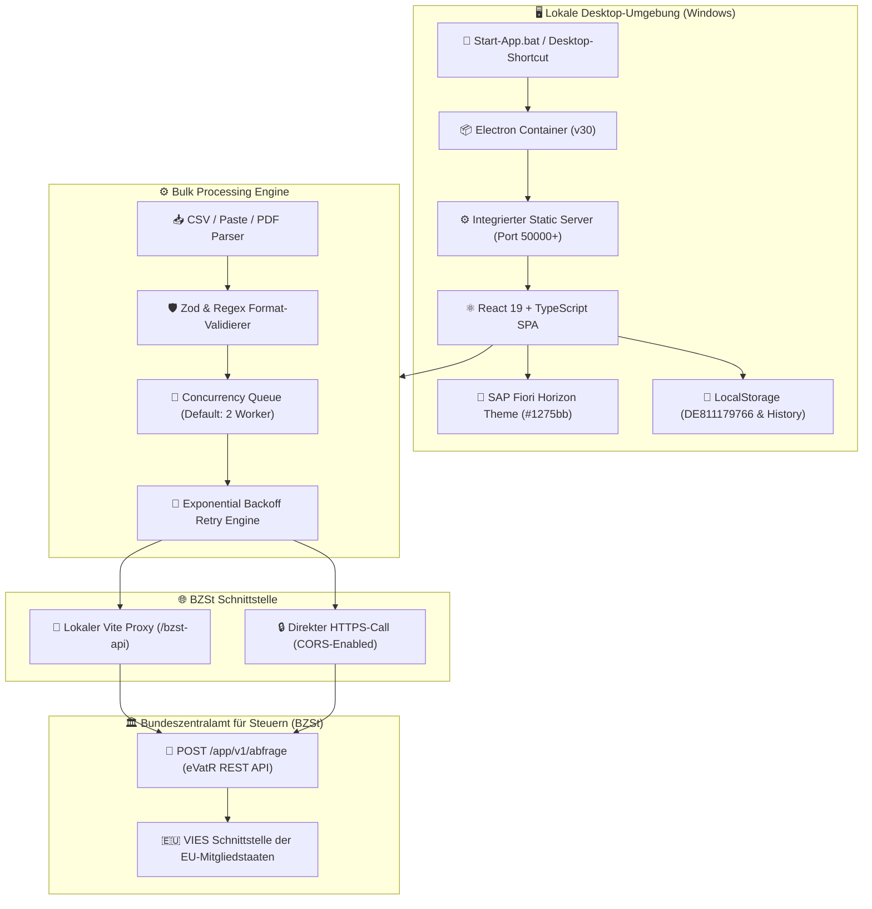
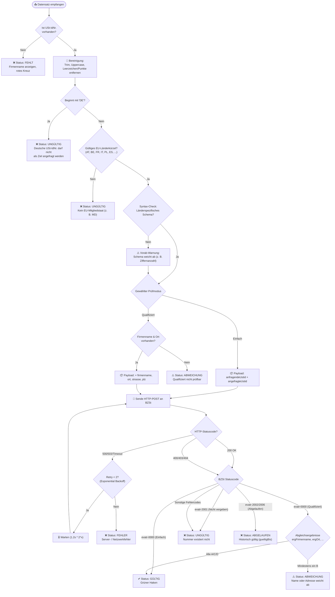
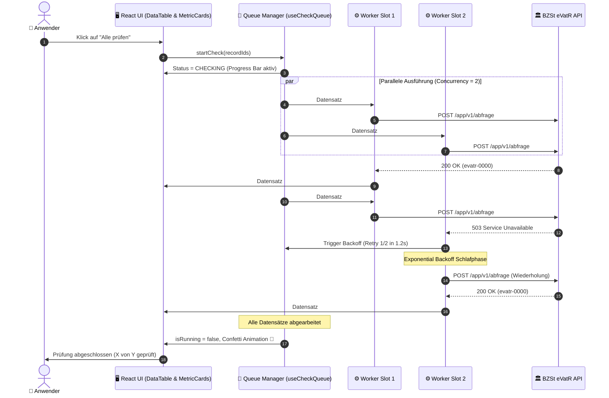
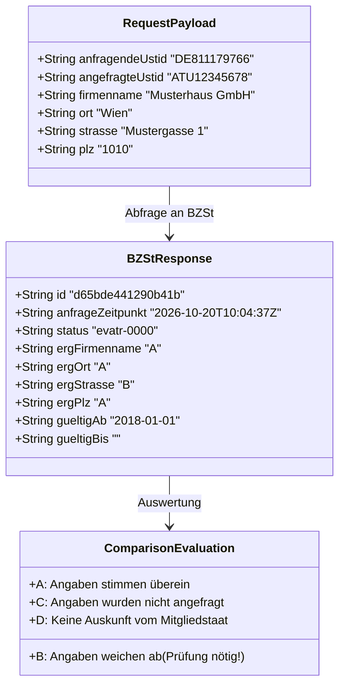
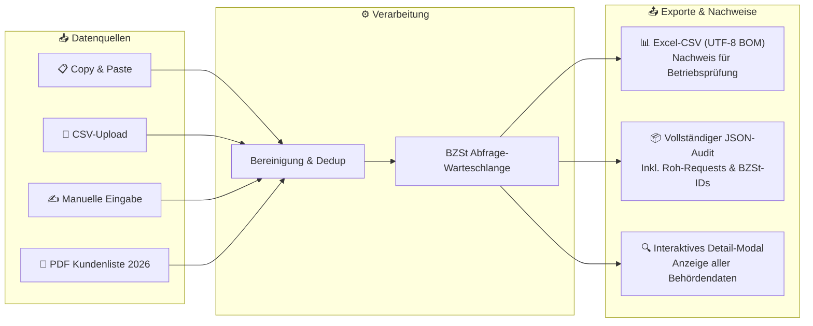

# 🛡️ USt-ID Bulk Checker (RocketUST-ID)

<div align="center">


**High-Performance Enterprise-Desktop-Anwendung im SAP Fiori Horizon Design zur automatisierten Massenprüfung ausländischer EU-Umsatzsteuer-Identifikationsnummern über die offizielle REST-Schnittstelle des Bundeszentralamts für Steuern (BZSt eVatR).**

[Schnellstart](#-schnellstart) • [Systemarchitektur](#-systemarchitektur) • [Prüfprozess & Ablauf](#-prüfprozess--entscheidungslogik) • [Warteschlange & Concurrency](#-warteschlangen--concurrency-steuerung) • [Qualifizierter Datenabgleich](#-qualifizierter-datenabgleich-abcd) • [Statuscodes](#-vollständige-bzst-statuscode-referenz) • [Ordner 2026](#-dokumentationsordner-2026)

</div>

---

## 📋 Überblick & Nutzen

Für innergemeinschaftliche steuerfreie Lieferungen (§ 4 Nr. 1 Buchst. b UStG i. V. m. § 6a UStG) sind Unternehmen gesetzlich verpflichtet, die Gültigkeit der ausländischen USt-IdNr. des Geschäftspartners zum Zeitpunkt der Leistung nachzuweisen.

Manuelle Einzelabfragen beim Online-Portal des Bundeszentralamts für Steuern (BZSt) kosten bei hunderten Debitoren viele Arbeitsstunden. Der **USt-ID Bulk Checker** automatisiert diesen Prozess vollständig:
- ⚡ **200+ Nummern in wenigen Minuten** statt tagelanger manueller Recherche.
- 🏢 **SAP Fiori Horizon Enterprise UI** (abgestimmt auf die Firmenarchitektur von Zahn Pinsel GmbH / RocketMedia mit Brand-Farbton `#1275bb`).
- 📁 **Vollständige Transkription der Kundenliste 2026:** 170+ Datensätze aus `UST-ID-Nr 2026 SK.pdf` sind auf Knopfdruck abrufbereit.
- ❌ **Sonderbehandlung fehlender Nummern:** Kunden ohne hinterlegte USt-IdNr. werden mit Firmenname und rotem Kreuz (`Fehlt ❌`) dargestellt.
- 📄 **Rechtssicherer Prüfnachweis:** Export als Excel-kompatible CSV (mit UTF-8 BOM) und vollständiges JSON zur Vorlage bei Betriebsprüfungen.

---

## 🏛️ Systemarchitektur

Die Anwendung ist als hybride **Electron Desktop-App** konzipiert. Ein eingebetteter lokaler Node.js-Server eliminiert jegliche Browser-CORS-Restriktionen beim Zugriff auf die BZSt-Server.



---

## 🔄 Prüfprozess & Entscheidungslogik

Jeder Datensatz durchläuft eine mehrstufige Verifikationskette. Offensichtlich fehlerhafte Datensätze oder fehlende Nummern werden markiert, ohne den Gesamtprozess zu unterbrechen:



---

## 🚦 Warteschlangen- & Concurrency-Steuerung

Um das Sperren der IP-Adresse oder Session-Timeouts seitens der BZSt-Server zu verhindern, steuert der Worker-Hook [useCheckQueue.ts](file:///c:/UST-ID-Nr_Check/src/hooks/useCheckQueue.ts) die Anfragen über eine konfigurierbare Concurrency-Queue:



---

## 🔍 Qualifizierter Datenabgleich (A/B/C/D)

Bei der **qualifizierten Bestätigungsabfrage** vergleicht das BZSt die vom Anfragenden übermittelten Angaben mit der Datenbank des zuständigen EU-Mitgliedstaates.



### Bedeutung der Vergleichsbuchstaben:
| Code | Bedeutung | Darstellung im UI | Auswirkung auf Status |
|:---:|:---|:---|:---|
| **A** | **Stimmt überein** | <span style="color:#107e3e">● Grün (A)</span> | Gültig ✔ |
| **B** | **Stimmt nicht überein** | <span style="color:#bb0000">● Rot (B)</span> | **Abweichung vorhanden ⚠️** |
| **C** | **Nicht angefragt** | <span style="color:#556b82">● Grau (C)</span> | Gültig ✔ (Feld war optional) |
| **D** | **Vom EU-Staat nicht mitgeteilt** | <span style="color:#e9730c">● Orange (D)</span> | Gültig mit Hinweis (z. B. Staat führt keine Straßendaten) |

---

## 📊 Datenfluss & Export-Möglichkeiten



---

## 📑 Vollständige BZSt-Statuscode-Referenz

Die Anwendung übersetzt alle 26 offiziellen BZSt-eVatR-Meldungen automatisch in verständliche deutsche Texte:

| Statuscode | HTTP | Kategorie | Offizielle BZSt-Bedeutung | UI-Bewertung |
|:---|:---:|:---:|:---|:---:|
| **`evatr-0000`** | 200 | Ergebnis | Die angefragte USt-IdNr. ist zum Anfragezeitpunkt gültig. | **Gültig ✔** |
| **`evatr-0001`** | 400 | Hinweis | Bitte bestätigen Sie den Datenschutzhinweis. | Hinweis |
| **`evatr-0002`** | 400 | Hinweis | Mindestens eins der Pflichtfelder ist nicht besetzt. | Fehler ❌ |
| **`evatr-0003`** | 400 | Hinweis | USt-IdNr. ist gültig, aber Pflichtfelder für qualifizierte Abfrage fehlen. | Abweichung ⚠️ |
| **`evatr-0004`** | 400 | Fehler | Die anfragende DE USt-IdNr. ist syntaktisch falsch. | Eigene Nr. falsch |
| **`evatr-0005`** | 400 | Fehler | Die angegebene angefragte USt-IdNr. ist syntaktisch falsch. | Ungültig ❌ |
| **`evatr-0006`** | 403 | Hinweis | Die anfragende DE USt-IdNr. darf keine DE USt-IdNr. anfragen. | DE nicht erlaubt ❌ |
| **`evatr-0007`** | 403 | Hinweis | Fehlerhafter Aufruf der Schnittstelle. | Fehler ❌ |
| **`evatr-0008`** | 403 | Hinweis | Maximale Anzahl an qualifizierten Abfragen der Session erreicht. | Session-Limit |
| **`evatr-0011`** | 503 | Fehler | Bearbeitung zurzeit nicht möglich. Bitte später versuchen. | Retry / Fehler |
| **`evatr-0012`** | 400 | Fehler | Die USt-IdNr. passt nicht in das Erzeugungsschema des Landes. | Ungültig ❌ |
| **`evatr-0013`** | 503 | Fehler | Server überlastet. | Retry / Fehler |
| **`evatr-1001`** | 503 | Fehler | Systemüberlastung beim BZSt. | Retry / Fehler |
| **`evatr-1002..1004`** | 500 | Fehler | Interner Serverfehler im BZSt-Rechenzentrum. | Retry / Fehler |
| **`evatr-2001`** | 404 | Hinweis | Die angefragte USt-IdNr. ist zum Anfragezeitpunkt nicht vergeben. | **Ungültig ❌** |
| **`evatr-2002`** | 200 | Hinweis | Zum Anfragezeitpunkt noch nicht gültig (erst ab `gueltigAb`). | **Ungültig ❌** |
| **`evatr-2003`** | 400 | Fehler | Das angegebene Länderkennzeichen ist nicht gültig. | Ungültig ❌ |
| **`evatr-2004`** | 500 | Fehler | Mitgliedstaat nicht erreichbar (VIES-Ausfall im Partnerland). | Partnerland down |
| **`evatr-2005`** | 404 | Fehler | Die eigene DE USt-IdNr. ist zum Anfragezeitpunkt nicht gültig. | Eigene Nr. ungültig |
| **`evatr-2006`** | 200 | Hinweis | USt-IdNr. ist nicht mehr gültig (war gültig bis `gueltigBis`). | **Abgelaufen ❌** |
| **`evatr-2007`** | 500 | Fehler | Verarbeitungsfehler im angefragten Mitgliedstaat. | Partnerland-Fehler |
| **`evatr-2008`** | 200 | Hinweis | USt-IdNr. ist gültig. Für qualifizierte Abfrage liegt Besonderheit vor. | **Gültig mit Hinweis ✔** |
| **`evatr-2011..3011`** | 500 | Fehler | Allgemeine Verarbeitungsstörung beim BZSt. | Retry / Fehler |

---

## 📁 Dokumentationsordner `2026/`

Im Ordner [`c:\UST-ID-Nr_Check\2026\`](file:///c:/UST-ID-Nr_Check/2026) liegen alle Vorlagen und durchgeführten Nachweise für Steuerprüfungen und Audits:

| Datei | Beschreibung |
|:---|:---|
| **`UST-ID-Nr 2026 SK.pdf`** | Die Original-Kundenliste (Blatt 3 bis 8) mit allen 170+ Kundendaten. |
| **`ust_id_pruefung_2026-10-20.csv`** | Der durchgeführte Export-Prüfbericht mit Zeitstempel, BZSt-Statuscodes, Einzelabgleichen und IDs. |
| **`*.xlsx`** | Hier können Sie Ihre interne Excel-Dokumentation ergänzen. |

---

## 🚀 Schnellstart & Bedienung

### 1. App als native Desktop-App starten
Doppelklick auf die Verknüpfung auf Ihrem Windows-Desktop:
👉 **`USt-ID Bulk Checker.lnk`**

*(Alternativ: Doppelklick auf die Datei [Start-App.bat](file:///c:/UST-ID-Nr_Check/Start-App.bat))*

### 2. Im Browser starten (Entwicklermodus)
```bash
# 1. In das Verzeichnis wechseln
cd c:\UST-ID-Nr_Check

# 2. Entwicklungsserver starten
npm run dev

# 3. Aufrufen unter: http://localhost:5173/
```

### 3. Produktions-Build erstellen
```bash
npm run build
```

---

## 🛠️ Verwendete Technologien

- **Frontend-Framework:** [React 19](https://react.dev/) mit [TypeScript](https://www.typescriptlang.org/)
- **Bundler & DevServer:** [Vite 8](https://vitejs.dev/)
- **Desktop Runtime:** [Electron 30](https://www.electronjs.org/)
- **Styling:** [Tailwind CSS 3.4](https://tailwindcss.com/) im SAP Fiori Horizon Farbschema
- **Icons:** [Lucide React](https://lucide.dev/)
- **CSV-Engine:** [PapaParse](https://www.papaparse.com/)
- **Validierung:** [Zod](https://zod.dev/)
- **PDF-Engine:** [PDF.js (Mozilla)](https://mozilla.github.io/pdf.js/)
- **Animationen:** [Canvas-Confetti](https://www.npmjs.com/package/canvas-confetti)
